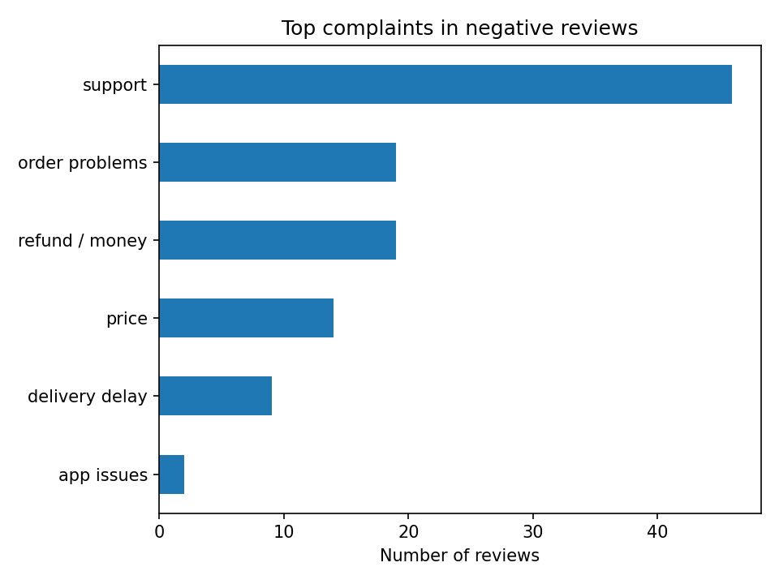

# Review Intelligence Tool

Analyses Google Play reviews of an app to find what users complain about most.
Case study: Swiggy (India), 500 most recent reviews.

## Problem
App reviews are unstructured. This tool turns them into ranked, evidence-backed insights.

## Method
1. Collected 500 recent reviews with `google-play-scraper`
2. Sentiment labelling with VADER (positive / neutral / negative)
3. Keyword-frequency analysis on negative reviews
4. Regex-based theme classification (support, refund, price, delivery, etc.)
5. Manually checked sample reviews to validate the "support" theme

## Findings
- Sentiment: 332 positive (66%), 101 negative (20%), 67 neutral (13%)
- Top complaint theme among the 101 negative reviews: **customer support (46 reviews)**
- Then: order problems (19), refund/money (19), price (14), delivery delay (9), app issues (2)
- Manual check: sampled support reviews were genuinely about unresponsive support, unresolved refunds and a removed support number

## Limitations
- Only 500 reviews from one source and one time window
- VADER is rule-based and can misread sarcasm
- Themes are keyword-based, so one review can match several themes

## Tech
Python, pandas, VADER, matplotlib, Google Colab

## Next steps
Streamlit dashboard, multi-app comparison, transformer-based sentiment
